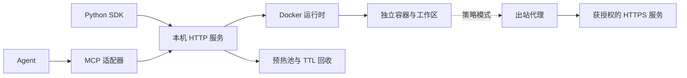

# LiteSandbox 使用指南

[返回项目首页](../README.md) · [快速开始](../README.md#快速开始)

## 后台执行与实时日志

启动长任务后立即获得 `run_id`。通过 `get_run()` 查状态、`run_logs()` 取当前日志快照，或通过 `stream_run()` 订阅输出。

```python
import base64
import sys

from litesandbox import LiteSandbox

with LiteSandbox().session() as sandbox:
    run_id = sandbox.start_run(
        ["sh", "-c", "echo starting; sleep 2; echo done"],
        timeout_seconds=30,
    )
    for event, data in sandbox.stream_run(run_id):
        if event in ("stdout", "stderr"):
            output = getattr(sys, event).buffer
            output.write(base64.b64decode(data["base64"]))
            output.flush()
        elif event == "done":
            print("状态", data["state"], "退出码", data["exit_code"])
```

需要中断时，可调用 `sandbox.cancel_run(run_id)`，再通过 `get_run()` 确认停止。取消和超时会作用于这条异步命令的进程组，工作区仍可供其他任务使用。

例如，在另一个客户端里停止某条后台命令，并等待最终状态：

```python
import time

sandbox.cancel_run(run_id)
while (status := sandbox.get_run(run_id))["finished_at"] is None:
    time.sleep(0.2)
print(status["state"], status["exit_code"])
```

这里的 `sandbox` 和 `run_id` 来自上面的会话。若命令在取消请求送达前已结束，查询会返回它实际完成的状态。

<details>
<summary>日志、超时与记录限制</summary>

- SSE 首先发送已保留的输出，再发增量数据。空闲时发送 `heartbeat`，结束时发送包含最终状态的 `done`。日志载荷是 Base64 编码的原始字节。
- stdout 和 stderr 各保留前 64 KiB。超出后标记 `truncated`。服务最多跟踪 16 条并发命令与 128 条执行记录，已完成的记录可被淘汰，管理服务重启后记录失效。
- 异步命令超时范围为 1–3600 秒，默认为 300 秒。TTL 独立计算。脱离原进程组的进程超出命令级取消范围。
- 同步 `exec()` 超时范围为 1–60 秒，默认为 10 秒。同步超时会销毁整个沙箱，响应中会标记 `timed_out` 和 `sandbox_destroyed`。

</details>

## 网络策略

| 模式 | Python 写法 | 网络行为 |
| :--- | :--- | :--- |
| **直接联网（默认）** | `session()` | 使用 Docker bridge 网络，普通预热容器也采用此模式。 |
| **完全离线** | `session(offline=True)` | 禁用 Docker 网络，仅保留容器回环接口。 |
| **代理出站** | `session(allowed_hosts=[...])` 或 `session(api_routes=[...])` | 沙箱无直接外网路由，经本地网关访问获授权的目标。 |

离线和代理模式按需创建。代理模式使用 `python:3.11-alpine`，建议提前在 Docker 宿主机拉取镜像。

### 允许 HTTPS 下载

```python
from litesandbox import LiteSandbox

with LiteSandbox().session(allowed_hosts=["pypi.org"]) as sandbox:
    result = sandbox.exec([
        "wget", "-q", "-O", "pip.json",
        "http://127.0.0.1:3128/https://pypi.org/pypi/pip/json",
    ])
    assert result.exit_code == 0, result.stderr
```

网关按精确域名放行 HTTPS `GET` / `HEAD`，检查解析地址和重定向目标。程序可使用环境变量 `LITESANDBOX_SOURCE_GATEWAY` 取得网关前缀。

<details>
<summary>为特定 API 路由授权并注入凭证</summary>

将下面的示例保存为 `routes.json`，把地址替换为实际服务。在宿主环境设置 `MODEL_API_TOKEN`，然后执行 `python -m litesandbox serve --api-routes-file routes.json`。

```json
{
  "model": {
    "url": "https://api.example.com/v1/request",
    "method": "POST",
    "token_env": "MODEL_API_TOKEN"
  }
}
```

使用 `LiteSandbox().session(api_routes=["model"])` 将该路由授权给指定沙箱。沙箱内向 `http://127.0.0.1:3128/api/model` POST 一个 JSON 对象。代理向预设的 HTTPS 地址发送请求并注入 Bearer 凭证，凭证不进入工作负载环境变量。

API 路由支持 `GET` / `POST`，拒绝重定向，POST 请求体上限为 1 MiB。下载和 API 响应上限均为 16 MiB。下载通道使用显式 URL 前缀，支持公共 IPv4 HTTPS 443 端口。

</details>

<details>
<summary>在本机浏览器预览沙箱里的网页</summary>

启动服务时加 `--preview-port 8766`，让沙箱内的网页服务在 `3000` 端口监听，再调用 `sandbox.preview_url(ttl_seconds=300)`。保持会话打开，把返回的地址粘贴到本机浏览器。预览网关支持小型 HTTP 页面及资源的 `GET` / `HEAD`，响应上限为 4 MiB，链接在到期、沙箱销毁或网关重启后失效。

下面是可运行的最小预览示例。先按上一段启用预览网关，再在另一个终端执行：

```python
from litesandbox import LiteSandbox

with LiteSandbox().session(ttl_seconds=600) as sandbox:
    sandbox.write_file("web.sh", r"""while true; do
    printf 'HTTP/1.0 200 OK\r\nContent-Type: text/html\r\nContent-Length: 12\r\n\r\n<p>Hello</p>' | busybox nc -l -p 3000 >/dev/null
done
""")
    result = sandbox.exec(["sh", "-c", "sh web.sh </dev/null >/dev/null 2>&1 &"])
    assert result.exit_code == 0, result.stderr
    print(sandbox.preview_url(), flush=True)
    input("按回车关闭沙箱。")
```

示例使用镜像内置的 BusyBox 提供最小的 HTTP 响应。实际应用可换成自己的 Web 服务。预览以独立本机地址区分不同沙箱，网关不会把浏览器的 Cookie 或认证头转交上游。

</details>

## 接入 Codex

在 Docker 和 LiteSandbox 服务运行后，从仓库目录启动：

```sh
python -m pip install -r requirements-mcp.txt
python run_agent.py "在沙箱里写一个 shell 脚本，执行后读回它生成的文件。"
```

启动器为任务创建沙箱，绑定 MCP 工具，并在 Codex 退出后尝试清理。MCP 提供文件读写、同步执行、后台执行、状态查询、日志快照和取消。SSE 日志订阅通过 HTTP 和 Python SDK 提供。如果 MCP 客户端使用工具白名单，按需启用 `exec`、`read_file`、`write_file`、`start_run`、`get_run`、`run_logs`、`cancel_run`。

## 性能数据

同一台机器、相同已缓存镜像、每组 20 次串行请求。两个指标分别来自各自的前后对照测试。

| 指标（P50） | 优化前 | 优化后 | 降幅 |
| :--- | ---: | ---: | ---: |
| 沙箱分配延迟 · 容器预热池 | 504 ms | **208 ms** | **59%** |
| 首条命令执行延迟 · 容器 ID 缓存 | 434 ms | **274 ms** | **37%** |

分配延迟算到创建接口返回，首条命令执行延迟从分配完成算到命令结果返回。预热池将创建成本前移，并在后台补充容器。

```sh
# 启动 10 个预热容器
python -m litesandbox serve --pool-size 10

# 另开终端运行，和 --pool-size 0 的同条件结果比较
python bench_sandboxes.py --attempts 20 --concurrency 1
```


## HTTP API

管理接口默认位于 `http://127.0.0.1:8765`。表中的 `{id}` 是沙箱 ID，`{run}` 是命令运行 ID。带请求体的接口使用 `Content-Type: application/json`。

| 方法与路径 | 参数或返回 |
| :--- | :--- |
| `GET /healthz` · `GET /readyz` | 检查 HTTP 服务是否响应，以及 Docker 是否可查询 |
| `POST /sandboxes` | 可传 `ttl_seconds`、`offline`、`allowed_hosts`、`api_routes`。返回 `201` 和 `sandbox_id`、`container_id`、`pool_hit` |
| `GET /sandboxes` · `GET /sandboxes/{id}` | 列出或查询沙箱，查看状态、到期时间和下载域名白名单 |
| `DELETE /sandboxes/{id}` | 删除沙箱，返回 `204`。重复删除同一 ID 可安全返回 |
| `POST /sandboxes/{id}/exec` | 传 `argv` 和可选的 `timeout_seconds`，等待命令结束并返回退出码与输出 |
| `POST /sandboxes/{id}/runs` | 参数同上，返回 `202` 和运行记录 |
| `GET /sandboxes/{id}/runs/{run}` | 查询状态、退出码和结束时间 |
| `GET /sandboxes/{id}/runs/{run}/logs` | 读取当前 stdout 和 stderr 快照 |
| `GET /sandboxes/{id}/runs/{run}/events` | SSE 订阅，逐步读取日志和完成事件 |
| `DELETE /sandboxes/{id}/runs/{run}` | 提交取消请求，后续查询确认最终状态 |
| `PUT /sandboxes/{id}/files` | 传 `path`、`content`，写入 UTF-8 文本 |
| `GET /sandboxes/{id}/files?path=result.txt` | 读取工作区文本及 `truncated` 标记 |
| `POST /sandboxes/{id}/preview` | 启用了预览网关时，传 `port: 3000` 和可选的 `ttl_seconds` 签发预览链接 |

文件路径相对工作区，父目录需已存在。写入请求的 JSON 上限为 4 KiB，SDK 的 `read_text()` 遇到截断会抛出 `LiteSandboxError`。HTTP 请求失败时，可通过 `LiteSandboxError.status` 判断状态码。

## 服务配置

```sh
python -m litesandbox serve --port 8765 --pool-size 4 --reap-interval 30
```

| 参数 | 默认值 | 用途 |
| :--- | :--- | :--- |
| `--port` | `8765` | 管理 HTTP 接口端口 |
| `--owner` | `local` | 用容器标签指定该服务管理的沙箱范围 |
| `--pool-size` | `0` | 提前启动的普通容器数量，取值 0–32 |
| `--reap-interval` | `30` 秒 | 检查并清理到期沙箱的周期 |
| `--preview-port` | 未启用 | 本机预览网关端口 |
| `--api-routes-file` | 未配置 | 宿主维护的 HTTPS API 路由 JSON 文件 |

创建沙箱时默认 TTL 为 300 秒，可设为 1–3600 秒。管理进程重启后使用同一个 `--owner`，服务会重新查找该范围内的存活容器。需要手动扫描并清理过期容器时，可运行 `python -m litesandbox recover --owner local`。

## 架构



服务面向可信的本机调用方，管理接口监听回环地址。常用实现入口包括 [HTTP 服务](../litesandbox.py)、[Python SDK](../litesandbox_client.py)、[异步执行](../litesandbox_runs.py)、[出站代理](../litesandbox_egress.py) 和 [MCP 适配器](../litesandbox_mcp.py)。
